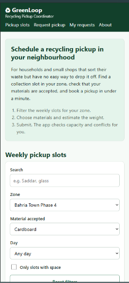
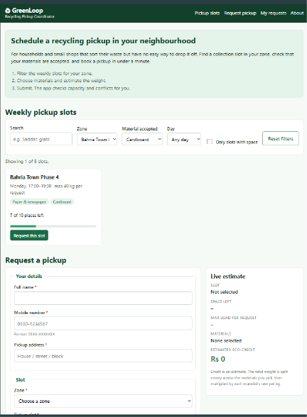
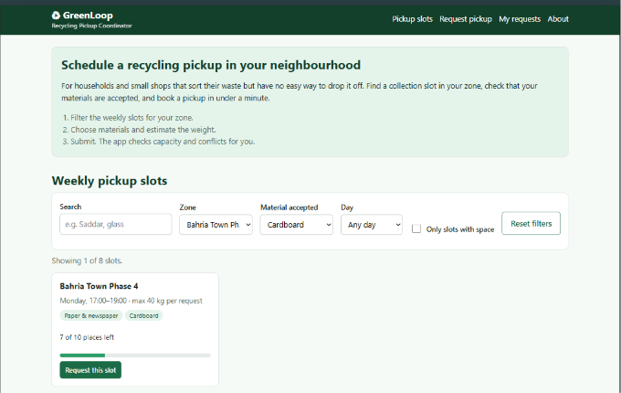

# GreenLoop – Recycling Pickup Coordinator

CS344 Web Engineering · Assignment 1 (Client-side web application) · BESE-14B

- **Assigned idea:** #19 Recycling Pickup Coordinator
- **Live URL:** https://ridanawaz2701.github.io/GreenLoop/

## What it does

Residents browse weekly recycling pickup slots by zone, material and day, then book a pickup. The app checks capacity, accepted materials, load limits, duplicates and same-day clashes, and estimates an eco-credit. Everything runs in the browser with no backend. Requests are kept in `localStorage`.

## Tech

Semantic HTML5, CSS (variables, Flexbox, Grid, breakpoints at 600px and 992px), vanilla JavaScript. No frameworks, libraries or templates.

## Run it locally

1. Clone the repo: `git clone <repo-url>`
2. Open the folder and double-click `index.html` (or run `python -m http.server` and visit `http://localhost:8000`).

## Deploy to GitHub Pages

1. Push the files to a GitHub repository.
2. Repository **Settings → Pages**.
3. Source: **Deploy from a branch**, branch `main`, folder `/ (root)`. Save.
4. After a minute the site is live at `https://<username>.github.io/<repo>/`.

## Files

| File | Purpose |
|---|---|
| `index.html` | Page structure and form |
| `styles.css` | Layout, responsive design, theme |
| `app.js` | Data, filtering, validation, conflict checks, calculation |
| `DESIGN_NOTE.md` | User/problem, WDLC, wireframes, client vs server |

## Requirements checklist

- Semantic HTML, labelled form with browser validation (`required`, `pattern`, `min`/`max`, input types)
- Selectors, box model, Flexbox and Grid, two media-query breakpoints (mobile, tablet, desktop)
- Variables, functions, arrays, conditionals, DOM events
- Two interactions: filter/search and request form with live calculation and conflict checking
- Empty and invalid input handled
- 8 student-created sample slot records (`SLOTS` in `app.js`)

## Screenshots

## Attribution and AI disclosure

All code is original apart from AI assistance (Claude by Anthropic) used to generate the initial draft of the project, which I reviewed, tested and can explain. No third-party libraries, images or templates are used. All sample data is fictional. No credentials or private data are included.
